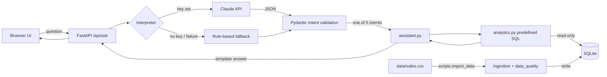

# Architecture

Browser → `POST /api/ask` → **interpreter** (Claude or rules → validated `Intent`) → **assistant** picks one predefined **analytics** function → parameterised SELECT on SQLite (read-only) → template answer + metrics + supporting rows → JSON → UI.

| Module | Role |
|---|---|
| `config.py` | env settings |
| `database.py` | schema, write connection (import only), read-only connection (analytics) |
| `services/data_quality.py` | pure row validation → category + flags |
| `services/ingestion.py` | idempotent CSV import, audit rows, summary |
| `services/analytics.py` | the 5 SQL analytics |
| `services/question_interpreter.py` | `Intent` model, Claude call, rule fallback |
| `services/assistant.py` | intent → analytics → answer templates |
| `api/routes.py`, `main.py`, `schemas.py` | HTTP layer, error handlers, startup import |

To add an agent framework (LangChain etc.) later: wrap the five analytics functions as tools; keep the same validation and read-only connection.
